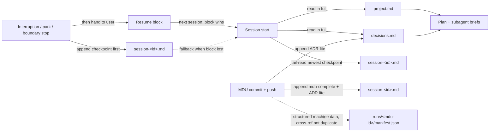

# MDU-04 — Lightweight Persistent Memory Convention

- **Status:** design complete — 2026-10-21
- **Scope:** orchestrator behavior + documentation only. No code, no config schema, no MCP, no new dependencies. Files touched: `prompts/orchestrator.md`, `grok/agents/orchestrator.md`, `opencode_agents/grok/agents/grokestrator.md` (overlay), `README.md`, this doc.
- **Why:** every session starts from zero; long projects lose context; there is no resume story beyond the pasted resume block (MDU-28), which is transport, not durable storage.

## Goals

1. Dependency-free, provider-neutral memory readable/writable identically by OpenCode, Grok Build, and Claude Code (Claude inherits via the generated orchestrator).
2. Fresh sessions start with the project's stable facts and past decisions instead of from zero.
3. Durable on-disk resume state: a checkpoint that survives session death, complementing the pasted resume block.
4. Append-only history — cheap to enforce, conflict-free, reviewable in PRs.

## Non-goals

- No subagent memory access. The orchestrator is the **single writer**; subagents receive facts via briefs. This avoids concurrency and scope creep.
- No semantic recall, embeddings, or cross-repo knowledge (see Upgrade Path).
- No `validate.py` changes in this MDU. Memory files are runtime artifacts of target projects, not build inputs. MDU-10 may add validation for committed checkpoint files.
- No automated tooling to read memory — orchestrator prompt rules are the entire mechanism.

## File layout

All files live in `.agents/memory/` **at the project being worked on** (cwd), not in the agent-definitions repo. Same placement rule as `agent-improvements.md`.

| File | `type` | Purpose | Created |
| --- | --- | --- | --- |
| `project.md` | `project` | Stable facts: stack, build/test commands, conventions, gotchas | Lazily, on first fact learned |
| `decisions.md` | `decisions` | ADR-lite entries: Context / Decision / Consequences | Lazily, on first durable decision |
| `session-<id>.md` | `session` | One session's chronological log: `session-start`, `mdu-complete`, `checkpoint` entries | Lazily, on first write |

### Frontmatter (all three file types)

```yaml
---
type: project            # project | decisions | session
created: 2026-10-21T10:02:00Z
updated: 2026-10-21T11:05:00Z
---
```

- `created` / `updated` are ISO-8601 UTC with `Z` suffix: `^\d{4}-\d{2}-\d{2}T\d{2}:\d{2}:\d{2}Z$`.
- Bodies are **append-only**: never edit, reorder, or delete existing entries. The only permitted mutation is bumping `updated:` when appending.
- Corrections are appended as superseding lines ("Correction (2026-10-21): …"), never rewrites of old lines.

### `project.md` — stable facts only

```markdown
## Build & Test
- `timeout 300 ./build.sh` regenerates build/; validator must exit 0.

## Conventions
- Tabs, not spaces, in scripts/lib.
```

Free-form headings, facts only, no session chatter. One line per fact keeps it greppable and bounded.

### `decisions.md` — ADR-lite

```markdown
## 2026-10-21 — Inline manifest schema in orchestrator prompt (MDU-15)
- Context: subagents cannot read docs/ in bare scratch workspaces; schema drifted per CLI.
- Decision: embed the full run-manifest contract inline in both orchestrator mirrors.
- Consequences: prompt grows ~35 lines; no external doc lookup; parity checks keep mirrors aligned.
```

One entry per durable decision; one line each for Context / Decision / Consequences. Append when an MDU makes a choice worth remembering, not for every trivial fix.

### `session-<id>.md` — per-session log

```markdown
## 2026-10-21T10:02:00Z — session-start
harness: opencode · goal: MDU-31 repo-ownership gates

## 2026-10-21T10:41:00Z — mdu-complete (mdu-31)
mdu_id: mdu-31 · branch: mdu-31-repo-ownership · commit: 1a2b3c4 · qa: PASS
summary: repo-ownership gate added to all orchestrator variants
key_decisions: gate applies per-action; upstream reports need explicit user instruction
ledger: runs/mdu-31/manifest.json

## 2026-10-21T11:05:00Z — checkpoint (mdu-32)
completed: design doc written (docs/design/mdu-32-*.md)
next: implement-phase brief to just-code
blockers: none
artifacts: docs/design/mdu-32-*.md
resume: new session; paste resume block; durable copy in session-20261021-1002.md
```

Three entry types (closed set): `session-start`, `mdu-complete (<mdu-id>)`, `checkpoint (<mdu-id>)`. One line per field. A final checkpoint at session end doubles as the session-end record — there is no separate `session-end` type.

### Session identity (`<id>`)

- Harness session id when known and filesystem-safe (e.g. `OPENCODE_SESSION_ID`), sanitized to `[a-z0-9-]`.
- Otherwise a UTC slug `YYYYMMDD-HHMM` (e.g. `session-20261021-1002.md`).
- Collision (same slug, different session): append to the existing file — never overwrite or fork a second file for the same id.

## Orchestrator contract (normative)

The identical rule block was appended after the run-ledger bullet in all three orchestrator files (`prompts/orchestrator.md`, `grok/agents/orchestrator.md`, overlay `grokestrator.md`); Claude Code inherits it via build-time generation from the OpenCode prompt. The contract:

1. **Session start — read.** Read `.agents/memory/project.md` and `.agents/memory/decisions.md` in full if they exist; fold facts and past decisions into the plan and subagent briefs. Absent files mean start fresh — do not create empty scaffolding.
2. **Read strategy (token frugality).** Never bulk-read session history. Tail-read only the **newest checkpoint entry** of the most recent `session-*.md` when resuming, or when no resume block is pasted and an in-flight checkpoint may exist — then surface it in one line and let the user choose.
3. **After each MDU is committed and pushed — append.** An `mdu-complete` entry with `mdu_id`, `branch`, `commit` (SHA), one-line `summary`, `key_decisions`, and the `runs/<mdu-id>/manifest.json` path. Append an ADR-lite entry to `decisions.md` when the MDU made a durable choice.
4. **On any interruption or park — append a checkpoint.** Triggers: the 30-minute forced checkpoint, compaction stop, cache-miss stop, session-boundary stop. Fields: `completed`, `next`, `blockers`, `artifacts` — mirroring the resume block handed to the user. **Append the checkpoint before ending the turn**, so it is durable even if the user never resumes.
5. **On resume.** The pasted resume block (MDU-28) is the primary transport and **wins if it disagrees** with the newest checkpoint; the on-disk checkpoint is the durable fallback when the block was lost. Either way, treat it as the starting state — never re-derive completed work.
6. **Stable facts.** Append to `project.md` when a durable fact is learned (build command, convention, gotcha).
7. **Safety.** Never write secrets into memory — the secret gate scans staged memory files like any other diff. If `.agents/memory/` is unwritable or the project gitignores it, note the skip and continue: memory failure never blocks an MDU.

## Relationship to existing conventions



- **Pasted resume block (MDU-28):** transport for the user; checkpoint entry is its durable on-disk twin with identical fields.
- **Run ledger (`runs/<mdu-id>/manifest.json`, MDU-15):** structured machine data per MDU. Memory holds narrative knowledge + resume state; entries **reference** the manifest path, never duplicate its fields.
- **`agent-improvements.md` (introspector):** process-improvement suggestions stay separate; do not merge into memory.
- **MDU-10 (checkpoint/resume protocol):** builds on this convention; may later add validator support for committed checkpoint files.

## Committing, gitignore, secrets

- Commit `project.md` and `decisions.md` — durable project knowledge; survives clones and PR review.
- Session files: commit by default for the audit trail; a project may gitignore them. The base repo does not add a gitignore rule in this MDU.
- The secret gate applies to memory files like any staged diff; memory must never contain credentials.

## Provider neutrality — rationale

Plain markdown + YAML frontmatter is the only artifact all three CLIs can read and write with zero configuration: no MCP server runtime, no SDK, no schema registry. Alternatives rejected:

- **MCP memory server** — requires per-CLI server config and a running process; violates "usable without MCP" degradation policy (MDU-06).
- **SQLite / JSON store** — binary or non-reviewable in PRs; needs tooling to inspect.
- **mem0 / Letta now** — heavyweight dependency for a problem this convention solves with 3 files (kept as optional upgrade path below).

## Edge cases

| Case | Behavior |
| --- | --- |
| `.agents/memory/` absent | Start fresh; create lazily on first write |
| Unwritable / gitignored by project choice | Note the skip; never block the MDU |
| Concurrent orchestrator sessions | Per-session files are isolated (`session-<id>.md`). `project.md` and `decisions.md` are shared — interleaved appends are possible and the `updated:` frontmatter bump is last-writer-wins; use append-only discipline and accept that. |
| Malformed frontmatter in an existing file | Treat body as plain text; still append; note the anomaly once |
| Checkpoint vs pasted block conflict | Pasted block wins (user intent); note the discrepancy |
| Very large `decisions.md` | Curated by append-only discipline; humans may archive old entries — agents never delete |

## Upgrade path (optional, heavy)

If a project outgrows file-based memory (semantic recall across thousands of entries, cross-repo knowledge graphs), **mem0** or **Letta** can be layered on as an optional MCP memory server. The contract is designed so a backend can replace the storage layer **without changing the orchestrator's read/append semantics** — keep `project`/`decisions`/`session` entry shapes stable and wrap them in the server. Not recommended by default: adds a runtime dependency and per-CLI config for marginal benefit at typical project scale.

## Acceptance test plan

Executed by `test-agent` (scriptable checks) + `qa` (harness-level grading) in a **throwaway scratch workspace** — never a real repo. Scratch root: `/tmp/opencode/mdu04/`. Each test maps to a backlog acceptance criterion.

### Setup (shared)

```bash
mkdir -p /tmp/opencode/mdu04/scratch/.agents/memory && cd /tmp/opencode/mdu04/scratch
git init -q && git commit -q --allow-empty -m "init"
cat > .agents/memory/project.md <<'EOF'
---
type: project
created: 2026-10-01T09:00:00Z
updated: 2026-10-01T09:00:00Z
---
## Build & Test
- ZUNIQUE_FACT: run `timeout 60 ./run_tests.sh` before any commit.
EOF
cat > .agents/memory/decisions.md <<'EOF'
---
type: decisions
created: 2026-10-01T09:00:00Z
updated: 2026-10-01T09:00:00Z
---
## 2026-10-01 — Use tabs not spaces (TEST-00)
- Context: mixed indentation caused diff noise.
- Decision: tabs everywhere in scripts.
- Consequences: editorconfig updated.
EOF
cat > .agents/memory/session-20261001-0900.md <<'EOF'
---
type: session
created: 2026-10-01T09:00:00Z
updated: 2026-10-01T09:30:00Z
---
## 2026-10-01T09:30:00Z — checkpoint (mdu-test-prev)
completed: prior phase done
next: nothing pending
blockers: none
artifacts: none
EOF
```

### Test 1 — Fresh session reads memory (criterion 1)

1. Start a fresh headless orchestrator session in the scratch repo with a neutral planning task: *"Plan a small change: rename module `old_util.py` to `new_util.py`. Do not implement."*
2. **PASS:** the reply/plan references at least one `ZUNIQUE_FACT` string or the tabs decision (grep the transcript for `run_tests.sh` or `tabs`). **PASS:** no memory file was modified (content byte-identical after the run).

### Test 2 — Mock MDU writes session + checkpoint (criterion 2)

1. Task: *"MDU-TEST-04: append one line to NOTES.md, run the full loop, commit on a branch."*
2. **PASS:** after commit, a **new** `.agents/memory/session-<new-id>.md` exists with:
   - frontmatter `type: session` and `created`/`updated` matching `^\d{4}-\d{2}-\d{2}T\d{2}:\d{2}:\d{2}Z$`;
   - a `## <ISO-8601> — mdu-complete (mdu-test-04)` entry;
   - `mdu_id`, `branch`, `commit` whose SHA matches `git log -1 --format=%H`;
   - one-line `summary`, `key_decisions`, `ledger` path.
3. **PASS (append-only):** `git diff` on `decisions.md`/`project.md` shows only `+` lines, never `-` lines, in pre-existing entries.
4. If a durable decision was made, `decisions.md` gains a `## <date> — <title> (mdu-test-04)` entry with Context/Decision/Consequences lines.

### Test 3 — Resume from checkpoint (criterion 3)

1. In a second scratch repo (same seed minus the prior session file), start a two-phase mock MDU: *"MDU-TEST-05: phase 1 = write DESIGN.md; phase 2 = implement from it."* Interrupt/stop the session after phase 1 lands (kill the headless run, or let the orchestrator park at its session boundary).
2. **PASS:** `session-<id>.md` contains a `checkpoint (mdu-test-05)` entry with non-empty `completed`, `next`, `blockers`, `artifacts`, written **before** the turn ended.
3. Start a fresh session pasting the resume block (per MDU-28): *"continue mdu-test-05 from the resume block"* with the block content.
4. **PASS:** the new session's plan starts at phase 2 — it references the checkpoint's `next`/`artifacts` (grep for `DESIGN.md`) and does **not** re-derive or rewrite phase-1 output (DESIGN.md content unchanged).
5. Variant: repeat step 3 **without** pasting the block; the orchestrator tail-reads the newest checkpoint, surfaces it in one line, and resumes only on user confirmation.

### Test 4 — README documents the convention (criterion 4)

1. **PASS:** `README.md` has a Persistent Memory section describing the three files, frontmatter, append-only rule, and orchestrator behavior.
2. **PASS:** its link to `docs/design/mdu-04-lightweight-persistent-memory.md` resolves.

### Grading notes for QA

- Scriptable assertions (frontmatter regexes, append-only `git diff` checks, SHA match, grep assertions) can be automated; harness-level behavior (fresh-session reads, resume-without-rederivation) is graded from session transcripts on whichever CLIs are available — at minimum the CLI this session runs in.
- A skip is a FAIL, not a pass-with-notes, for criteria 1–3.

## Implementation checklist (for the orchestrator loop)

- [x] Design doc (this file)
- [x] Memory rule block appended after the run-ledger bullet in `prompts/orchestrator.md` and `grok/agents/orchestrator.md` (identical text — parity-safe)
- [x] Same block appended to overlay `grok/agents/grokestrator.md`
- [x] README "Persistent Memory" section under "How the Agents Work Together"
- [ ] Review sign-off, test-agent run of the plan above, QA PASS
- [ ] Commit gates that apply: secret gate; **prompt regression gate** (this MDU touches `prompts/` and `grok/agents/`); parity via `./build.sh`
