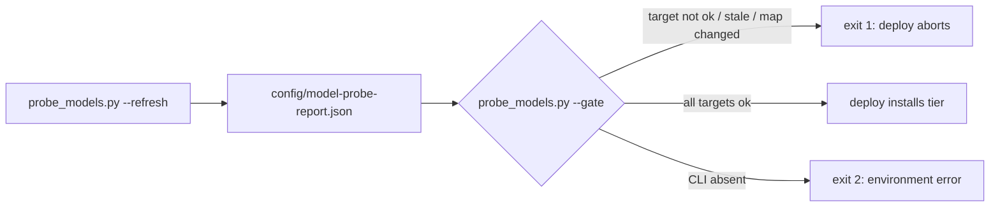

# MDU-38 Design — Pre-spawn model-health probe (live inference gate)

**Date:** 2026-10-29 · **Status:** design complete, ready for implement
**Incident:** mdu-37 (`.agents/memory/decisions.md` 2026-10-28; `project.md` §gotcha)
**Depends on:** MDU-33 (`zen-model-map.json`, `gen_zen_config.py`), MDU-36 (overlay two-tier deploy)

## Context

OpenCode's registry lists models as `active` even after upstream kills or quota-caps them. Every
existing check is a *listing* check: `check_live()` diffs `config/model-registry.txt` against
`opencode models`, and CI has no `opencode` CLI by design, so nothing runs inference. mdu-37 routed 12
agents to `opencode/nemotron-3-ultra-free` (dead upstream); three spawns failed with
`Model is unavailable` before anyone noticed. The proven manual probe:

```bash
timeout 90 opencode run -m <model-id> "Reply with exactly: OK"
```

This MDU turns that into a script, a durable JSON report, and a fail-closed gate at the only place a
deploy happens (the overlay). **No pre-spawn hook** — OpenCode exposes none; the gate runs before
*install* and the report is the shared artefact.



## D1 — Probe script: `scripts/lib/probe_models.py`

**Verdict: new standalone CLI; probes map targets + `overrides` (hard) and alternates (warn); one
`opencode run` per model; 2 attempts with permanent-vs-transient classification; no report merge.**

```
probe_models.py --refresh | --gate | --refresh --gate     # one mode required
  [--map FILE]          default <repo>/config/zen-model-map.json
  [--report FILE]       default <repo>/config/model-probe-report.json
  [--config FILE]       optional opencode.json for a read-only ref diff (D4)
  [--timeout 90] [--attempts 2] [--max-workers 2]
  [--max-age-days 7] [--max-runtime-s 300] [--cli opencode]
```

Probe set (deduped, stable order): `map.models.values() | map.overrides.values()` are **targets**,
`map.alternates` are **alternates** (a model in both is a target); the map is what `gen_zen_config.py`
emits, so it defines the hot paths.

| Rule | Detail |
|---|---|
| Command | `[cli, "run", "-m", model, "Reply with exactly: OK"]`, `capture_output=True, text=True, check=False` |
| Success | `returncode == 0` **and** `stdout.strip() == "OK"` (exact match, so `NOT OK` / `OKChrome` are failures); 0-exit without an exact `OK` is a **fail** (`no OK in output`) — a truncated run is not proof of inference |
| Permanent (no retry, `attempts=1`) | `Model is unavailable`, `model not found`, `not found`, `404`, `invalid model` |
| Transient (retry once) | `TimeoutExpired`, `429`/`rate limit`, `5xx`, connection/DNS; unknown failures also retry once, then fail |
| CLI absent | `shutil.which(cli) is None` → all `skipped`, **exit 2, write no report**; `sleep(1)` between attempts only |

`runner` is injected — `probe_one(model, *, cli, timeout, attempts, runner=subprocess.run)` — so tests
stub inference with no subprocesses (same discipline as `check_live`). Report written atomically
(`tmp` + `os.replace`), with `[ok]/[warn]/[fail]` stdout lines:

```json
{"schema_version": 1, "probed_at": "2026-10-29T11:04:02Z", "mode": "refresh",
 "cli": "opencode", "timeout_s": 90, "map_path": "config/zen-model-map.json",
 "map_sha256": "<sha256 of canonical json.dumps(map, sort_keys=True)>",
 "results": [
   {"model": "opencode/big-pickle", "role": "target", "status": "ok", "attempts": 1, "latency_s": 3.41, "error": null},
   {"model": "opencode/beam-free", "role": "alternate", "status": "fail", "attempts": 1, "latency_s": 0.82, "error": "Model is unavailable"}]}
```

`status ∈ {ok, fail, skipped}`. `map_sha256` hashes **canonicalised JSON**, not raw bytes, so the
overlay's re-indented `build/zen-model-map.json` hashes identically to the base map.

**Merge policy: none — `--refresh` rewrites the whole report (last run wins).** Seven models are cheap
to probe and any union policy can preserve an `ok` for a model that has since died — exactly the
mdu-37 failure. Hence one report-level `probed_at`, no per-model timestamps. **`--refresh` exits 0
whenever the report was written**, even if models failed (result is data; grading is `--gate`); exit 2
only for absent CLI, missing/unreadable map, or unwritable report. So AC-1 holds while
`--refresh --gate` still fails closed.

## D2 — Gate semantics and wiring

**Verdict: gate is a mode of the same script, evaluated against the report only; hard gate in the
overlay `deploy.sh` with documented `--skip-probe`, warn-only in base `deploy.sh`; never in CI.**

Gate rules, evaluated in order, all offences collected and printed:

1. Report missing / unreadable / malformed, `schema_version != 1`, unparsable or >1 h future
   `probed_at` → exit 1 + bootstrap command.
2. `map_sha256` differs from the current map → exit 1, `map changed since last probe`.
3. `now - probed_at > max-age-days` (strict) → exit 1, unless `--max-age-days 0`.
4. Every **target** needs exactly one result with `status == "ok"`; missing, `fail`, and `skipped`
   all fail (a skipped probe must never satisfy freshness — the reason a no-CLI refresh writes nothing).
5. **Alternates**: `fail`/`skipped`/missing → `[warn]` only.
6. `--config FILE`: free `opencode/*` refs absent from the report → `[warn]` only (D4).

| Code | Meaning |
|---|---|
| 0 | green: all targets ok, report fresh, map hash matches |
| 1 | red: any rule 1–4 offence, offenders listed one per line |
| 2 | cannot evaluate: CLI absent, map missing, bad arguments, report unwritable |

Same 0/1/2 convention as `resume_block.py`; `model_registry.py` uses 2 for usage.

| File | Behaviour |
|---|---|
| `opencode_agents/scripts/deploy.sh` | **Hard gate after `resolve_sources`/`ensure_tier_sources`, before any copy:** `python3 "${GENERIC_DIR}/scripts/lib/probe_models.py" --gate --map "${BUILD_DIR}/zen-model-map.json" --report "${OVERLAY_ROOT}/config/model-probe-report.json"`. Non-zero aborts `--force`; a **dry run** prints and continues. `--skip-probe` skips the call with `[warn] model-health probe SKIPPED (--skip-probe)`, documented in the usage header. |
| `open-agent-definitions/scripts/deploy.sh` | **Warn-only.** Same call with `--map "${REPO_ROOT}/config/zen-model-map.json"`; never aborts, `[info]` when CLI/report absent (public repo, foreign users). One usage-header line. |
| `scripts/build.sh`, `.github/workflows/ci.yml`, `.gitignore` (both repos) | **Unchanged behaviour** in build/CI: no CLI (ci.yml steps 1–4), listing-only drift check, comment only. Add `config/model-probe-report.json` to both `.gitignore`s — generated, machine-local, and committing it would gate one machine on another's probe and invite timestamp edits (`runs/` precedent). |

Deploy order: `build` (if `--rebuild`) → **probe gate** → copy → `validate_deployed_clis`. A dead
target never reaches `~/.config/opencode/`.

## D3 — Freshness policy and bootstrap

**Verdict: `--max-age-days 7`; absent report = gate exit 1 (fail closed) with the bootstrap command
printed; `--refresh --gate` is the one-command first run and the documented routine.**

7 days: free models die on a days timescale (mdu-37 rotated mid-week) and a probe costs ~30 s; 1 day
nags every deploy, 30 days would have hidden the nemotron outage for most of its life. Absent report
reads red on the overlay but only `[info]` in the base. Bootstrap: `python3
scripts/lib/probe_models.py --refresh --gate` — exit 0 only if every target answered, and the report
still lands on failure as evidence. Rule 2 forces a re-probe after any map edit, so a stale `ok` can
never bless a newly mapped model; `--max-age-days 0` disables *only* the age rule (still requires `ok`
+ hash match), never as a way to silence a dead model.

## D4 — Which model sets are probed

**Verdict: map targets + `overrides` (hard), alternates (warn); no sweeping of all `opencode/*` refs —
that sweep stays a read-only warning diff under `--config`, because it adds zero new probes today.**

Measured 2026-10-29 (base `opencode.json` and overlay merged `build/opencode.json` — identical free sets):

| Set | Unique models | Count |
|---|---|---|
| `map.models.values()` | `opencode/big-pickle`, `opencode/nemotron-3.5-lightning-free` | 2 |
| `map.overrides.values()` | empty | 0 |
| `map.alternates` | `nemotron-3.5-super-vl-free`, `mimo-v2.6-flash-free`, `deepseek-v4.1-flash-free`, `flint-40b-free`, `beam-free` | 5 |
| **unique `opencode/*` refs in merged `opencode.json`** | `big-pickle`, `mimo-v2.6-flash-free`, `nemotron-3.5-lightning-free` | **3** |

Total probe set: **7 models**, and all 3 config refs are already inside it. Runtime ≈ 30 s serial /
~15 s at 2 workers. `--max-runtime-s 300` caps the schedule, but it gates only the **start** of new
probes: each probe re-checks the deadline when it begins and, once the deadline has passed, the
remainder is `skipped` and the gate is therefore red — never a silent pass. A probe already in flight
is not interrupted; it finishes under its own per-attempt `--timeout` (and at most `--attempts`
attempts), so wall clock can overrun the budget by at most one such probe — ≈ 180 s at the defaults
(2 × 90 s) — never unboundedly.

Under `--config`, free refs missing from the report are `[warn]`, so a future hardcoded
`opencode/foo-free` agent (which `gen_zen_config.py` passes through) cannot hide; promoting that to a
failure is rejected because it couples the gate to the merged config. Grok `xai/*` and
`opencode-go/*` are excluded by construction (only `opencode/` is probed).

## D5 — Docs and deploy ordering

**Verdict: one new section in `docs/model-registry.md` (probe/gate/refresh), one README note, one
overlay deploy-header line — plus correction of the mdu-37-stale rows already in that doc.**

- New §"Live model-health probe (MDU-38)" after §Zen variant mapping: what `active` does not mean, the
  probe command, report path/schema, gate rules + exit-code table, `--refresh`, `--max-age-days`,
  `--skip-probe`, the 7-model probe set, and the incident trust rule: *no model enters
  `zen-model-map.json` without a green probe.* Corrections in the same pass (wrong after mdu-37):
  §Research still puts `deepseek-research` on `opencode/nemotron-3-ultra-free`, §Model-keyed mapping
  still names `nemotron-3-ultra-free` as a target, and §Alternates lists six models that are no longer
  the map's alternates — regenerate those tables from `config/zen-model-map.json`.
- `README.md`: deploys are gated on a fresh probe report; `--skip-probe` exists; probing is local-only,
  never in CI. Overlay (separate commit/push): `scripts/deploy.sh` usage header gains `--skip-probe`,
  README/AGENTS gains one deploy-note line; base deploy header gains one advisory line.
- Documented order: **(1) build → (2) probe gate → (3) install → (4) `opencode debug agents`.**

## D6 — Test surface (`tests/test_mdu_38_model_probe.py`, ~18 cases)

**Verdict: unit tests via injected `runner` plus file-level gate tests; no subprocesses, no network;
deploy wiring asserted by reading the shell scripts (convention: `test_mdu_30`, `test_mdu_33`).**

- `probe_one`: ok (0 + `OK`) → `ok`, 1 attempt; 0 without `OK` → `fail`; permanent signal → `fail`,
  1 attempt; timeout→ok → `ok`, 2 attempts; timeout twice → `fail`, 2 attempts.
- Report + refresh: key set, sorted results, `schema_version`, ISO `probed_at`, stable `map_sha256`;
  `--refresh` writes and exits 0 with a failing model; CLI absent → exit 2 and **no report**.
- `--gate`: all-ok → 0; target `fail` → 1 + id on stderr; alternate/free-ref warnings → 0; target
  missing → 1; target `skipped` → 1; missing report → 1 + bootstrap hint; stale (8 days) → 1 while
  `--max-age-days 0` → 0; `map_sha256` mismatch → 1; malformed JSON → 1; CLI absent → 2.
- `--refresh --gate` end-to-end with a stubbed mixed run → 1, report on disk.
- Wiring/docs: overlay `scripts/deploy.sh` contains the gate call and `--skip-probe`; base call is
  advisory; `docs/model-registry.md` carries the probe/gate/refresh strings; `ci.yml` has no
  `probe_models` invocation.

`python3 -m pytest tests/ -q` green; `./build.sh` unchanged and green (probe is outside the build path,
so the only build risk is doc/`.gitignore` edits).

## D7 — Non-goals

**Verdict: OpenCode free Zen only — no Grok/Claude or paid-tier probing, no scheduled CI probing, no
auto-remap, no quality evaluation.**

Grok `xai/*` is covered by `validate.py`'s allowlist and a different CLI (`grok models`); Claude
subagents are model-less. `opencode-go/*` paid models are assumed healthy (paid failures are another
incident class; probes cost money) and stay listing-checked. The probe answers "can it answer at all",
not "is it good" — hence alternates are warn-only. No CI wiring, cron, systemd timer, or OpenCode hook:
CI has no CLI by design and the gate sits where a human is present. No automatic remapping: the gate
fails loudly and the operator edits the map using the report as evidence (auto-failover is its own MDU).

## Acceptance criteria

1. `python3 scripts/lib/probe_models.py --refresh` probes every zen-map target, override target, and
   alternate live via `opencode run` and writes `config/model-probe-report.json` in the D1 schema,
   exit 0 when the report was written.
2. `--gate` exits 0 only when every mapped target is `ok`, `probed_at` is within `--max-age-days`
   (default 7), and `map_sha256` matches; otherwise 1 with offenders listed. Alternate failures warn
   only. Exit 2 = gate not evaluable (no CLI / no map / bad args).
3. `opencode_agents/scripts/deploy.sh` runs the gate from the base tree (`GENERIC_DIR`) before any
   install and aborts `--force` on non-zero; `--skip-probe` is documented in the usage header and
   prints an explicit warning. Base `deploy.sh` calls it warn-only.
4. `tests/test_mdu_38_model_probe.py` covers D6; `python3 -m pytest tests/ -q` and `./build.sh` are
   green; `ci.yml` still contains no live probe.
5. `docs/model-registry.md` documents probe, gate rules/exit codes, refresh + bootstrap workflow, and
   the 7-model probe set; the mdu-37-stale rows are corrected.

## File touch list

**Base (`open-agent-definitions/`)** — new `scripts/lib/probe_models.py`, new
`tests/test_mdu_38_model_probe.py`, new `docs/design/mdu-38-model-health-probe.md`; edit
`scripts/deploy.sh` (advisory call + usage line), `.gitignore`, `docs/model-registry.md`,
`README.md`, `.github/workflows/ci.yml` (comment only).

**Overlay (`opencode_agents/`, separate commit + push)** — edit `scripts/deploy.sh` (hard gate,
`--skip-probe`, usage header), `.gitignore`, README/AGENTS (one deploy-note line).

## Risks / notes for the implementer

- `opencode run -m <id> "..."` is the only inference interface proven here (mdu-37). Do not substitute
  `opencode models` — that is the check that already lied.
- The overlay rebuilds `build/zen-model-map.json` with different indentation; hash canonical JSON or the
  gate stays red after every build. Its report path is `<overlay>/config/model-probe-report.json`
  (create dir, keep untracked) — do not point it into the base tree, or two repos share one clock.
- Base is the public repo: a missing report must never break a stranger's deploy. Manual probes in docs
  keep `timeout 90`.
